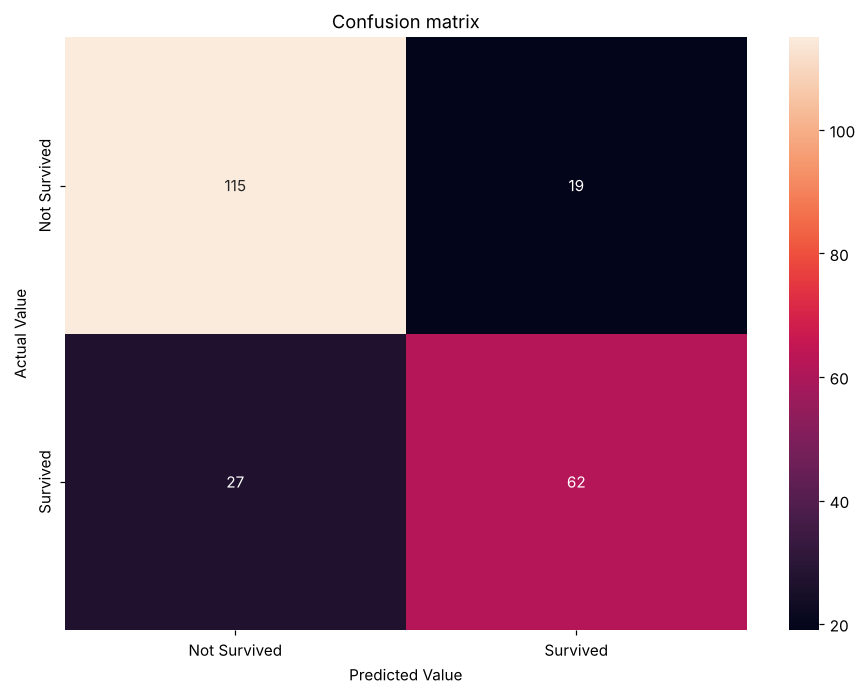

# Titanic survival classifier (k-nearest neighbors)

An end-to-end scikit-learn pipeline that predicts whether a Titanic passenger survived.

## Data

`Titanic_Data.csv` is Kaggle's labelled training set: 891 passengers, 38% of whom survived.

## Pipeline (`Main.py`)

1. **Clean.** Drops ID, name, ticket and cabin. Fills missing ages with the median for that passenger's class, missing fares with the median fare, and missing ports with the most common one. Encodes sex and port as numbers.
2. **Engineer features.** Family size, travelling alone, fare quartile and age band.
3. **Split and scale.** 75/25 train/test split (`random_state=42`), then a `MinMaxScaler` fitted on the training rows only.
4. **Tune.** `GridSearchCV` with 5-fold cross-validation over 120 settings: k from 1 to 20, three distance metrics (Euclidean, Manhattan, Minkowski) and two weightings (uniform, distance).
5. **Evaluate.** Accuracy and a confusion-matrix heat map on the 223 held-out passengers.

## Results

| | |
|---|---|
| Best model | k = 7, Manhattan distance, uniform weights |
| Cross-validated accuracy (training set) | 82.9% |
| Test accuracy (223 held-out passengers) | **79.4%** |
| Baseline: always predict "did not survive" | 60.1% |



Of 134 passengers who died, 115 were predicted correctly. Of 89 who survived, 62 were.

## Run it

```bash
pip install pandas numpy scikit-learn matplotlib seaborn
python Main.py
```
